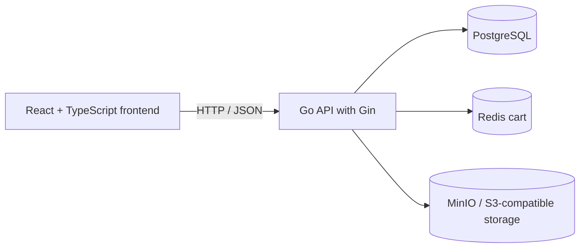

# Dakeh

Dakeh is a full-stack e-commerce project built with **Go, Gin, PostgreSQL, Redis, MinIO, React, TypeScript, and Vite**. It is being developed as a practical example of a layered Go API and a real shopping experience, including authentication, catalog browsing, a cart, saved addresses, favorites, and product reviews.

> **Project status:** active development. The current source snapshot includes the cart and customer-account features listed below. Persistent orders/checkout and payment are not yet included in this snapshot. See [Roadmap](#roadmap) and [the database diagram](docs/schema.md) for the distinction between current and planned schema.

## Features

### Implemented in this source snapshot

- **Authentication:** registration, login, short-lived JWT access tokens, refresh-token rotation, logout, and log out everywhere.
- **Customer account:** profile details and account-scoped data.
- **Delivery addresses:** create, view, edit, and delete saved addresses, with coordinates selected on a map and one default address per customer.
- **Catalog:** public product browsing, category and tag data, product details, variants, prices, inventory availability, and product images.
- **Admin API:** protected catalog-management endpoints for products, categories, tags, variants, stock, and images. There is no full admin frontend yet.
- **Product images:** image metadata is stored in PostgreSQL and image objects are stored in MinIO/S3-compatible storage.
- **Shopping cart:** a guest cart in the browser and an authenticated cart stored in Redis; guest items can be merged after login. The API rechecks current product data and stock.
- **Favorites:** save products, list saved products, and remove favorites.
- **Reviews:** public product-review lists, authenticated review creation/editing/deletion, one review per user per product, and a user-level “My reviews” list. A database trigger keeps product rating averages/counts in sync.
- **API inspector:** the frontend includes an inspector for requests and responses, with a copy-as-cURL helper.

### Not included in the uploaded source snapshot yet

- Persisted orders and order history.
- Payment provider integration.
- Admin dashboard, password reset, and production deployment automation.

The cart page may show checkout UI placeholders, but an order is not created until an order/checkout implementation is merged into this codebase. Payment should be treated as a separate future phase.

## Tech stack

| Area | Technology |
|---|---|
| Backend language | Go (module currently declares Go `1.26.0`) |
| HTTP | Gin |
| Database | PostgreSQL 16 |
| Database access | pgx v5 and SQLC-generated queries |
| Migrations | Goose |
| Cart / cache | Redis 7 |
| Object storage | MinIO locally; S3-compatible storage can be configured |
| Authentication | JWT access tokens, refresh tokens, bcrypt password hashing |
| Frontend | React 18, TypeScript, Vite, Tailwind CSS |
| Frontend data / routing | TanStack Query, React Router |
| Maps | React Leaflet / OpenStreetMap |
| Local services | Docker Compose |

## Architecture

The backend follows a layered structure with manual dependency injection. HTTP handlers translate requests and responses, use cases coordinate application rules, repositories talk to PostgreSQL or Redis, and the domain package contains shared business concepts.



```text
cmd/api/                         API entry point
internal/
  app/                           Dependency wiring and route registration
  config/ env/                   Environment configuration
  domain/                        Domain types and errors
  usecase/                       Application services and business rules
  repository/
    postgres/                    PostgreSQL repositories
    redis/                       Redis cart repository
  transport/http/                Gin handlers, request DTOs, responses
  middleware/                    Authentication, roles, CORS
  security/                      JWT and password/refresh-token helpers
  storage/                       MinIO/S3-compatible object storage

db/
  migrations/                    Goose SQL migrations
  queries/                       SQL source queries for SQLC
  sqlc/                          Generated SQLC code (do not hand-edit)

frontend/
  src/components/                 Reusable UI components
  src/lib/                        API client, auth, cart, types, utilities
  src/pages/                      Shop, product, cart, account, and auth pages

docs/
  API.md                          API design plan / roadmap
  schema.md                       Current ER diagram and planned checkout schema
```

## Getting started

### Prerequisites

- Go version compatible with the `go 1.26.0` directive in `go.mod`.
- Docker Desktop (or Docker Engine with Compose).
- [Task](https://taskfile.dev/) to run the repository's development commands.
- Goose on your `PATH` for database migrations. SQLC is needed when regenerating database code.
- Node.js 20 or newer and npm for the frontend.

### 1. Configure the environment

From the repository root, copy the example environment file:

**Windows PowerShell**

```powershell
Copy-Item .env.example .env
```

**macOS / Linux**

```bash
cp .env.example .env
```

The example is intended for local development. Change the sample credentials/secrets before exposing services or deploying anywhere. Keep your real `.env` out of version control.

### 2. Start PostgreSQL, Redis, and MinIO

```bash
docker compose up -d
```

The compose file binds these development services to localhost: PostgreSQL on `5432`, Redis on `6379`, and MinIO on `9000` (console on `9001`). The API also requires the matching `DATABASE_URL`, Redis settings, JWT secret, and `S3_*` settings from `.env`.

### 3. Apply database migrations

```bash
task migrate:up
```

Check migration status with `task migrate:status`. The checked-in migrations create the current relational schema through reviews.

### 4. Start the API

```bash
task run
```

Or use `task dev` to start Compose services, apply migrations, and run the API in sequence.

- API base path: `http://localhost:8080/api/v1`
- Health check: `http://localhost:8080/healthz`

There is no Swagger UI route registered in the current source snapshot. `docs/API.md` is a design plan and may describe endpoints that are planned or whose names differ from the current handlers; use the route registrations in `internal/app/routes.go` and each handler's `Register...Routes` method as the implementation source of truth.

### 5. Start the frontend

Open another terminal:

```powershell
cd frontend
Copy-Item .env.example .env
npm install
npm run dev
```

On macOS/Linux, use `cp .env.example .env` instead of `Copy-Item`. Open `http://localhost:5173`. The default `VITE_API_URL` is `http://localhost:8080/api/v1`; override it in `frontend/.env` when the API runs elsewhere.

Useful frontend checks:

```bash
npm run typecheck
npm run build
```

For more frontend-specific details, see [frontend/README.md](frontend/README.md).

## Development commands

Run these from the repository root:

| Command | Purpose |
|---|---|
| `task` | List available tasks |
| `task run` | Run the API |
| `task dev` | Start services, migrate, and run the API |
| `task build` | Build the API binary into `bin/` |
| `task test` | Run Go tests |
| `task lint` | Run `golangci-lint` (must be installed) |
| `task sqlc` | Regenerate Go query code from `db/queries` |
| `task db:up` | Start Docker Compose services |
| `task db:down` | Stop containers while keeping volumes |
| `task db:reset` | Stop containers and **delete all Compose volumes/data** |
| `task migrate:up` | Apply pending migrations |
| `task migrate:down` | Roll back the latest migration |
| `task migrate:status` | Show migration status |
| `task migrate:create -- add_some_table` | Create a Goose migration skeleton |

**Caution:** `task db:reset` removes Docker volumes and permanently deletes local database, Redis, and MinIO data.

## API overview

The current API is rooted at `/api/v1`. Authenticated endpoints use `Authorization: Bearer <access-token>` unless the handler uses another token-based flow.

| Area | Implemented route examples |
|---|---|
| Health | `GET /healthz` |
| Authentication | `POST /auth/register`, `/auth/login`, `/auth/refresh`, `/auth/logout`; authenticated `POST /auth/logout-all` |
| Account | `GET /users/me` |
| Addresses | `GET/POST /users/address`; `GET/PUT/DELETE /users/address/{id}` |
| Public catalog | `GET /categories`, `/tags`, `/products`, `/products/{slug}` |
| Cart (authenticated) | `GET/DELETE /cart`; `PUT /cart/items/{variant_id}`; `DELETE /cart/items/{variant_id}`; `POST /cart/merge` |
| Favorites (authenticated) | `GET /favorites`; `PUT /favorites/{product_id}`; `DELETE /favorites/{product_id}` |
| Product reviews | Public `GET /products/{product_id}/reviews`; authenticated create/edit/delete and personal review queries |
| My reviews (authenticated) | `GET /reviews?page=1&page_size=10` |
| Catalog administration | Admin-protected routes under `/admin`, including products, categories, tags, variants, stock, and images |

The review handler currently names its product path parameter `:slug` for Gin route-tree compatibility, while the frontend sends the product UUID in that segment. Treat this as a naming quirk in the current code, not as a slug-based review endpoint.

For the complete intended endpoint roadmap, consult [docs/API.md](docs/API.md). It is explicitly a plan, not a generated OpenAPI specification.

## Data and design notes

- Product and variant prices are stored as integer minor units (currently interpreted by the frontend as USD cents); do not use floating-point numbers for money.
- Product variants carry SKU, price, attributes, and stock availability.
- The cart is in Redis for signed-in users and in browser storage for guests; it is not a PostgreSQL table.
- Product image files live in MinIO/S3-compatible object storage. PostgreSQL stores image metadata and URLs.
- Review rows are unique per `(product_id, user_id)`. A PostgreSQL trigger keeps `products.avg_rating` and `products.rating_count` in sync.
- See [docs/schema.md](docs/schema.md) for a Mermaid ER diagram of the current schema and a clearly separated checkout/order design extension.

## Roadmap

- [x] Foundation: Go/Gin app, configuration, Compose services, migrations, SQLC setup
- [x] Authentication and user profile reads
- [x] Address management
- [x] Catalog browsing and admin catalog APIs
- [x] Redis cart and guest-cart merge
- [x] Favorites and product reviews
- [ ] Persisted checkout and order history
- [ ] Payment provider integration (after order submission is stable)
- [ ] Admin web UI
- [ ] Expanded integration tests, API contract/OpenAPI, deployment hardening

## Security and production readiness

This is an actively developed project, not a production-ready commerce platform. Before production use, review secret handling, token storage/rotation, rate limiting, authorization, logging, backups, image access policies, order/payment state transitions, taxes/shipping, fraud controls, and integration tests. Never deploy with the local credentials from `.env.example`.

## License

MIT (see [LICENSE](LICENSE) if present in the repository).
