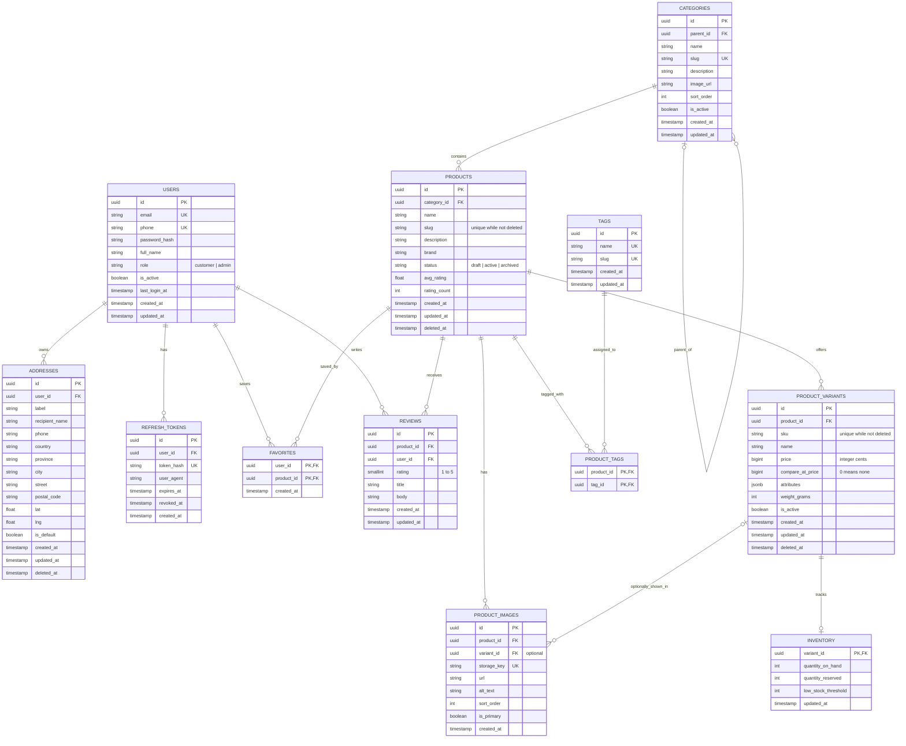
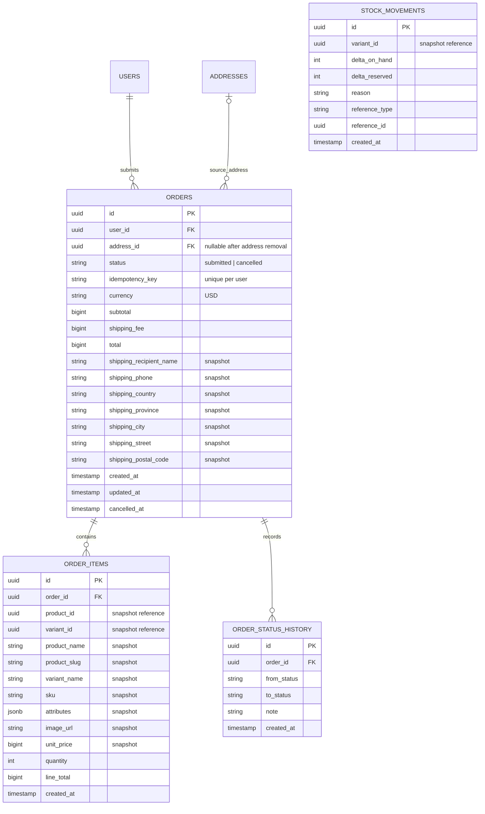

# Dakeh Database Schema

This page keeps the schema diagram as Mermaid so GitHub can render it directly. The first diagram describes tables present in the current migrations (`db/migrations/00001` through `00010`). The cart is stored in Redis and therefore does not appear in the relational diagram.

All product/variant prices are integer minor units. The frontend currently presents them as USD cents.

## Current database schema

### Notes on the current schema

- `favorites` has a composite primary key on `(user_id, product_id)`, preventing duplicate favorites.
- `reviews` has a unique constraint on `(product_id, user_id)`: one review per customer per product. A trigger maintains the product's average rating and review count.
- A product or variant may be soft-deleted; its `deleted_at` column preserves the row when historical references may matter.
- `inventory.quantity_reserved` cannot exceed `quantity_on_hand`. Available stock is `quantity_on_hand - quantity_reserved`.
- Product image bytes are not stored in PostgreSQL. The database stores each object's storage key and public URL; MinIO/S3 stores the object itself.
- The current migration set does **not** create `orders`, `order_items`, `payments`, or checkout stock-movement tables.

## Checkout/order extension (planned separately)

The following is a design view for the order-submission patch, not a description of migrations `00001`–`00010`. It becomes part of the active schema only after the matching order migration is merged and applied.

In this first checkout phase, an order is submitted without charging a payment method. Product/variant identifiers and display details are snapshots in `order_items` so later catalog edits/deletions do not rewrite the customer's order history. `stock_movements.reference_type` and `reference_id` can refer to the order, but this is a polymorphic reference rather than a PostgreSQL foreign key, so the diagram does not draw it as a relational edge. Payment tables/provider callbacks should be added in a later phase rather than implied by this diagram.
